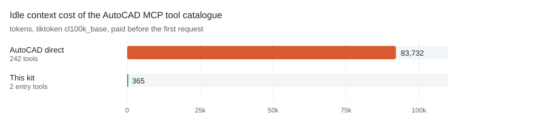

# dsh-cad

[](LICENSE)
[](https://www.npmjs.com/package/dsh-cad)
[](https://github.com/awesome-dsh-plugin/awesome-dsh-plugin)

**One MCP server and one skill that let a DeepSeek Harness or Codex agent drive real AutoCAD.**
They wire up the existing open-source [U-C4N/Autocad-MCP](https://github.com/U-C4N/Autocad-MCP)
project so an agent can draw in AutoCAD and export the result. This repository is the
configuration layer: an isolated environment, launch parameters, on-demand loading and client
registration. It does not fork, patch or repackage the server. Upstream hides its catalogue behind
its own discovery mode, so this repository configures it rather than shipping a shim.

English | [中文](README.zh.md)

## What it does, and when you want it

A CLI agent that can read a drawing is useful. One that can *produce* one is a different tool. With this
kit installed, dsh or Codex can take a sentence like "draw an M6 threaded-hole bracket on an ISO A3 sheet
and export PDF" and actually do it — create layers, draw geometry, dimension it, stamp a title block,
run a validator, and hand back a file.

The catch is the same as every COM automation: **AutoCAD must be running, and the agent must run as the
same Windows user and integrity level as AutoCAD.** This is not a cloud service and there is no headless
substitute for native `.dwg` output.

One skill is the entry point. It loads lazily — the SKILL.md is read only when a request matches its
description, so an idle session pays nothing for it:

| Skill | How it works |
|---|---|
| `autocad-mcp-pro` | Authored here (upstream ships no AutoCAD skill). Drives the AutoCAD MCP through its two meta-tools |

One MCP server is the muscle, registered in the client config:

| Server | Tools advertised | Idle cost | Mode |
|---|---:|---:|---|
| `autocad` | 2 | 365 tokens | Upstream `DISCOVERY_MODE=search`: only `search_tools` + `call_tool`; the 242-tool catalog is searched by keyword |

<picture>
  <source media="(prefers-color-scheme: dark)" srcset="docs/token-cost-dark.svg">
  
</picture>

*Tool schemas are paid for before the first request. Connected directly the server costs 83,732 tokens;
through this kit it costs 365, a 99.6% cut. Both are measured the same way: the `tools/list` bytes on the
wire, counted with `cl100k_base`.*

```
you speak natural language
   │
   ├─ dsh / Codex lazily loads a skill by its SKILL.md description
   │      └─ autocad-mcp-pro   → search_tools / call_tool → MCP → AutoCAD
   │
   └─ MCP server (cordis.patch.yml / codex config.toml)
          └─ autocad   upstream discovery mode, 242 tools on demand
```

## What is upstream, what is ours

This matters more than usual here, because the server is other people's work. The split is:

| Part | Origin | License |
|---|---|---|
| AutoCAD MCP server (`autocad-mcp-pro`) | [U-C4N/Autocad-MCP](https://github.com/U-C4N/Autocad-MCP), installed from PyPI | MIT |
| `skills/autocad-mcp-pro/SKILL.md` | Authored here — upstream has no AutoCAD skill | MIT |
| `bin/`, `lib/` (including `probe.py`, which checks for the AutoCAD COM server), `package.json`, `cordis.patch.yml`, `install.ps1`, `bootstrap.ps1`, `codex-config.snippet.toml`, `assets/`, READMEs | Authored here | MIT |

**Nothing upstream is vendored.** The installer fetches the PyPI package at install time, so you always
get upstream's current code and upstream keeps ownership of it. The value this repository adds is the
part that was missing: verified launch parameters, the discovery-mode configuration, the on-demand
skill wiring, the junction trick that keeps gigabytes off C:, and an installer that keeps the runtime
off the system drive.

**One exception, and it is deliberate:** `patches/` carries two fixes for upstream defects that are
silent — a vertical linear dimension measures 0.0, and an angular dimension's DXF sweep disagrees with
its COM measurement. Both are open as a pull request upstream; until it lands, `install.ps1` applies
the patches to the installed copy and `bootstrap.ps1` reports whether they are in place. See
[`patches/README.md`](patches/README.md).

## Install

Three ways in. Pick one, then check the prerequisites at the end of this section.

### 1. As a dsh plugin (recommended)

```bash
dsh plugin --profile web add dsh-cad
```

That is the whole install. `package.json` declares `dsh.bundle.patch`, so dsh picks up this
repository's `cordis.patch.yml`, which inserts one row: this package. The package is a real cordis
plugin (`lib/index.js`), not a wrapper around a binary, so dsh imports it from the profile and
nothing has to be on PATH.

On first load the plugin resolves its own paths, installs the pinned upstream server if it is
missing (a few minutes, once), and then registers the MCP client with absolute paths. If the
install cannot succeed it throws with the failing path and the command to re-run, instead of
registering a row that would fail silently. `CAD_NO_AUTO_INSTALL=1` turns the automatic install off
and surfaces the missing piece as an error instead.

### 2. npm, global (adds the CLI)

```bash
npm install -g dsh-cad
dsh-cad install
```

Same result, plus `dsh-cad` on PATH for `doctor`, `where` and `serve` — useful when you want to
check the install without booting dsh.

### 3. Without npm: `bootstrap.ps1`

```powershell
git clone https://github.com/echogyf/dsh-cad.git
cd dsh-cad
.\bootstrap.ps1 -Check     # report only, changes nothing; exits 1 if something is missing
.\bootstrap.ps1            # install whatever is missing
```

It inspects each piece and repairs only what is absent or stale:

| Check | Fixed by |
|---|---|
| Python ≥ 3.11 | nothing — it reports the problem and stops |
| `venv-autocad` + `autocad-mcp-pro` | `install.ps1` |
| `~/.dsh/skills` junction | created |
| dsh profile bundle entry | `install.ps1` (backs the file up first) |
| `~/.codex/skills` junction | created |
| `~/.codex/config.toml` entry | appended, with a backup |
| upstream patches | `install.ps1` / `bootstrap.ps1` |

Running it twice is a no-op. It exits `0` when everything is in place and `1` otherwise, so it is safe to
wrap in a script or hand to an agent. Nothing is downloaded unless a core piece is actually missing.

> [!WARNING]
> Route 3 also writes `~/.dsh/cordis.patch.yml`. If you installed the plugin as well, that is a second
> registration of the same server under the same `serverName`, and dsh refuses the duplicate — the
> session fails to start. Use one route or the other, not both: with the plugin installed, keep
> `~/.dsh/cordis.patch.yml` at `[]`.

### Commands

| Command | What it does |
|---|---|
| `dsh-cad install` | install the pinned upstream server and write `~/.dsh/cad.json` |
| `dsh-cad doctor` | report present/missing pieces and the pinned version, change nothing, exit 1 if something is missing |
| `dsh-cad where` | print every path the server will use |
| `dsh-cad serve autocad` | run the MCP server over stdio, for manual testing |

`install` is idempotent, and the plugin runs it for you on first load. The version is pinned in
`lib/upstream.json` — `autocad-mcp-pro` 1.6.0 — so a machine that installs today and one that installs
next month get the same server.

> [!TIP]
> **Rather not run any of this yourself?** Paste the block below into dsh, Codex, or any agent that can
> run commands on this machine. It carries everything the agent needs, so you can read the rest of this
> section only if something goes wrong.

```text
Install https://github.com/echogyf/dsh-cad on this Windows machine.

Run: npm install -g dsh-cad && dsh-cad install
That installs the package, then the upstream AutoCAD MCP server plus the client
entry. dsh-cad install is idempotent and only touches what is missing.

Do not run it elevated: it must run as the same Windows user as AutoCAD.
It writes nothing on C: except ~/.dsh and ~/.codex, and never touches the
AutoCAD installation or the registry.
Then verify with: dsh-cad doctor, dsh --profile headless --dump-config, codex mcp list.
Report any step that fails instead of silently working around it.
```

### Prerequisites

- Windows 10/11 with AutoCAD installed
- Python ≥ 3.11 on PATH (`python --version`)
- dsh (DeepSeek Harness) or Codex CLI; Node ≥ 20 for routes 1 and 2

### What if AutoCAD is not installed

The plugin checks for the AutoCAD COM server before registering anything (`lib/probe.py`, a registry
ProgID lookup — it does not launch the application). A machine without AutoCAD registers nothing and
says so in the log instead of offering tools that could only fail.

```
[dsh-cad] autocad: no COM server registered on this machine, not registering it
```

`CAD_DISABLE=autocad` turns that decision into a setting, `CAD_ASSUME=autocad` forces it on when the
registry probe is wrong, and `dsh-cad doctor` prints what the probe found without starting dsh.

Note that *installed* is not the same as *running*. AutoCAD registered but closed means the AutoCAD
tools wait for the application and then fail with a message about a modal dialog. Starting AutoCAD as
the same Windows user as your agent is the last step of any install.

### Version support

Upstream verifies against a single release but writes for a range. The honest picture:

| CAD | Verified | Expected to work | Why |
|---|---|---|---|
| AutoCAD | 2026 (every COM path, live run), 2027 (API compatible) | 2025 / 2024 / 2023 | COM goes through the long-stable ActiveX API. Run the upstream `scripts\smoke_*_com.py` against your build to confirm. And if COM cannot do something on your version, the ezdxf backend still can — it needs no AutoCAD at all. |

Older versions are not refused — nothing checks a version number. They are simply outside what upstream
verified, so start with one small job and look at the result before trusting a full drawing.

**What this package itself has run.** The live verification below was done on AutoCAD 2026 in October
2026; it is the only AutoCAD build this package has been run against.

### Appendix — upstream's own install steps

These are the upstream project's own instructions. This is also what `install.ps1` automates, so read it
if you want to understand or debug the install.

**AutoCAD MCP server** — [upstream install](https://github.com/U-C4N/Autocad-MCP#install). Into a venv on
the data drive (recommended here):

```powershell
python -m venv D:\cad-agents\venv-autocad
D:\cad-agents\venv-autocad\Scripts\python.exe -m pip install "autocad-mcp-pro[full]"
D:\cad-agents\venv-autocad\Scripts\autocad-mcp.exe --help    # stdio server entry point
```

Upstream's own one-liners, if you do not want a venv:

```bash
pip install autocad-mcp-pro              # or: uvx autocad-mcp-pro
autocad-mcp                              # backend auto-selected
AUTOCAD_MCP_BACKEND=ezdxf autocad-mcp    # headless DXF, no AutoCAD needed
AUTOCAD_MCP_BACKEND=com   autocad-mcp    # live AutoCAD (needs the [com] extra)
```

Extras: `[com]` = live AutoCAD control (pywin32 + Pillow), `[pdf]` = matplotlib for PDF/PNG output,
`[office]` = openpyxl for XLSX takeoffs, `[full]` = all of them. Upstream also documents an HTTP
transport (`autocad-mcp --transport http --port 8000`) and a JSON config for Claude Desktop / Cursor.

**Register the server with your client.** dsh reads `~/.dsh/cordis.patch.yml` — copy this repository's
`cordis.patch.yml` there. It inserts one row — this package — and the plugin registers the server
itself, so nothing has to be on PATH (`npm install -g dsh-cad`). Codex reads `~/.codex/config.toml` —
append `codex-config.snippet.toml`. The Codex snippet contains absolute paths, so adjust those to your
`-BaseDir`.

**Make the skill visible.** Both clients only scan their own skills directory:

```powershell
# dsh: one junction for the whole skills folder (matches what install.ps1 does)
New-Item -ItemType Directory -Force -Path "$env:USERPROFILE\.dsh" | Out-Null
New-Item -ItemType Junction -Path "$env:USERPROFILE\.dsh\skills" -Target "D:\cad-agents\dsh-skills"

# Codex: one junction per skill (its skills folder may hold other skills)
New-Item -ItemType Directory -Force -Path "$env:USERPROFILE\.codex\skills" | Out-Null
New-Item -ItemType Junction -Path "$env:USERPROFILE\.codex\skills\autocad-mcp-pro" -Target "D:\cad-agents\dsh-skills\autocad-mcp-pro"
```

### Appendix — what `install.ps1` does

`install.ps1` runs everything in the appendix above, plus the parts that are easy to get wrong: the venv
on the data drive, the junctions, the discovery-mode parameters, and a timestamped backup of the dsh
profile package.

```powershell
powershell -ExecutionPolicy Bypass -File .\install.ps1

# custom locations / force rebuild
.\install.ps1 -BaseDir "E:\cad" -WorkDir "E:\AutoCad" -Force
```

It checks Python, creates the directories, builds the venv, installs `autocad-mcp-pro[full]`, applies
`patches/` to the installed copy, junctions the skill into `~/.dsh/skills`, writes the dsh profile entry,
and drops the AutoCAD skill in place.

If you are not sure what is already on the machine, run `bootstrap.ps1` instead: it decides whether
`install.ps1` is needed at all.

**Codex users still need one step** — append `codex-config.snippet.toml` to `~/.codex/config.toml` and
junction the skill into `~/.codex/skills/` (last two commands of the appendix above).

> [!IMPORTANT]
> **Start AutoCAD first, as the same user.** COM automation crosses a process boundary that Windows
> guards by user and integrity level. An agent started elevated while AutoCAD runs normally (or vice
> versa) will connect to nothing, and the failure looks like "the tool did nothing".
>
> This rule is specific to COM. [`dsh-nx`](https://github.com/27painter/dsh-nx) drives NX through
> NXOpen, which runs inside the NX process — an open NX window cannot be attached to there, so that
> plugin starts its own batch session and must **not** be pre-opened. Do not carry this habit across.

## Usage

Just describe the drawing. The skill loads itself.

```text
Open AutoCAD, draw a bearing housing: base 120×80×10, upright 60 high × 12 thick,
φ40 through hole on top. ISO A3 sheet with title block and dimensions, save to
D:\AutoCad and export PDF.
```

Practical notes, learned the hard way:

- **AutoCAD tools take flat arguments.** A call looks like
  `call_tool(name="entity_create_line", arguments={"x1": 0, "y1": 0, "x2": 100, "y2": 0})`.
- **Ask for a plan first on anything complex.** The skill has a planning step; approving a plan before
  geometry is drawn is cheaper than undoing a bad drawing.
- **Ask for the preview.** The AutoCAD path ends in an 8-step validator plus a screenshot. "Show me the
  preview" is a fair request and the skill honors it. One caveat, measured here: the AutoCAD screenshot
  needs the window to be visible — with AutoCAD hidden or minimised it comes back blank. The geometry
  itself is always verifiable through the API (handles, bounding boxes, mass properties), so do not
  treat a blank image as a failed drawing.

## Verification

```powershell
# everything present? read-only, exits 1 if something is missing
dsh-cad doctor

# every path the server will use
dsh-cad where

# dsh sees the server and the skill
pnpm dsh --profile headless --dump-config
pnpm dsh --profile headless "list available skills"

# are the upstream patches still in place? read-only, exits 1 when one drifted
python patches\apply_patches.py --check

# the MCP server answers a handshake through the same entry point dsh uses
node bin\dsh-cad.mjs serve autocad        # expects AutoCAD MCP Pro, 2 entry tools

# Codex
codex mcp list
```

What was verified before publishing in October 2026, against a live application (AutoCAD 2026 running
at the time): `system_status` returns `connected: true`, `backend: com`, the running version and the
active document name; `drawing_info` returns the open document's entity count, extents and units;
`layer_list` returns the live layer table. The `serve` target also answers a JSON-RPC handshake through
the package's own binary — the AutoCAD server reports `AutoCAD MCP Pro 3.4.11` (the pip package is
1.6.0, the server carries its own version) and advertises 2 entry tools. Discovery finds
`gear_draw_spur_front_view` / `keyway_draw_keyed_bore` by keyword; `dsh --dump-config` loads the row
from this package.

## Design notes

**1. Discovery mode is the whole trick.** 242 tool schemas cost 83,732 tokens if advertised. In discovery
mode the client sees two tools (365 tokens) and searches a catalog that carries 206 AutoCAD command names
plus 1439 synonyms — say "chamfer" and it finds `FILLET`.

**2. Keep `TOOL_PROFILE=full` and `TOOL_PACKS=all`.** They only narrow the *searchable* catalog and do not
change idle cost. Measured: `lean + core,mech` drops the catalog to 58 tools and makes the parametric gear
and keyway tools unfindable. Narrowing packs loses capability without saving a token.

**3. Junctions, not copies.** dsh only scans `~/.dsh/skills`, Codex only scans `~/.codex/skills`. Directory
junctions point both at the data drive; neither tool notices. Deleting a junction does not delete data.

**4. Scope the file access.** The AutoCAD server's `ALLOWED_PATHS` is empty by default, and its own README
says to set it. This kit sets it to a working directory.

**5. Know what is verified.** The version table under Install says it plainly: upstream verified AutoCAD
2026. Everything else is expected, not proven — run one small job first.

**6. Discovery is not free, it is deferred.** Every tool call costs one extra round trip: search, then
call. For a single "draw a box" that is slower than calling the upstream tool directly. It is the right
trade when a session makes several calls, which is the normal case for CAD work.

**7. It ships as a plugin, not as a bin the patch calls.** The first version registered an MCP client row
whose `command` was `dsh-cad`, which only resolves when the package is installed globally — so
`dsh plugin add` on its own left a row that could not start. A reviewer caught that, correctly.
`lib/index.js` now imports as a cordis plugin and registers the client itself with an absolute path,
which removes the PATH dependency and lets it check the upstream before registering anything.

**8. Pinned, because "latest" is not a version.** `lib/upstream.json` records the exact
`autocad-mcp-pro` release this bundle was validated against; `install.ps1` uses it for the pip install.
Bumping it is a deliberate commit.

## Troubleshooting

| Symptom | Cause / fix |
|---|---|
| dsh lists no skills | `~/.dsh/skills` must be a junction whose target exists; folder name must equal the frontmatter `name` |
| Codex lists no skills | the junction under `~/.codex/skills\`; Codex must support skills |
| AutoCAD tools return nothing | AutoCAD not running, or different user/integrity level; set `AUTOCAD_MCP_BACKEND=com` to rule out the ezdxf fallback |
| `codex mcp list` empty | the snippet must sit at the end of `config.toml`; paths need doubled backslashes |
| Vertical dimensions measure 0.0 | the upstream patch is not applied; run `python patches\apply_patches.py` |
| Installer reports drift | upstream changed the anchor text; check whether the fix shipped, then update `patches/apply_patches.py` |

## License

MIT (see [LICENSE](LICENSE)). Upstream components remain under their own MIT licenses; this repository
redistributes neither.
