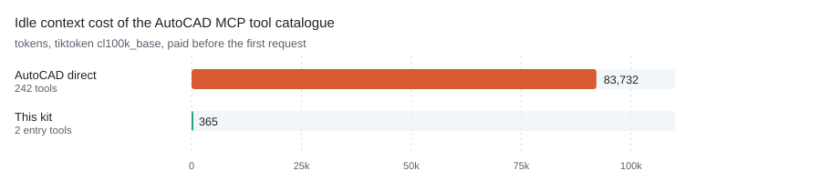

# dsh-cad

[](LICENSE)
[](https://www.npmjs.com/package/dsh-cad)
[](https://github.com/awesome-dsh-plugin/awesome-dsh-plugin)

**一个 MCP 服务器 + 一个 Skill，让 DeepSeek Harness 或 Codex 的 agent 真正操控 AutoCAD。**
它封装了现成的开源项目 [U-C4N/Autocad-MCP](https://github.com/U-C4N/Autocad-MCP)，
让 agent 能在 AutoCAD 里画图并把结果导出。本仓库是**配置层**：隔离环境、启动参数、按需加载、
客户端注册。它不 fork、不魔改、不重新分发这个服务器。上游自带 discovery 模式，所以本仓库
不再提供垫片，只负责把它配置起来。

[English](README.md) | 中文

## 它做什么，什么时候需要它

一个能"看懂"图纸的 CLI agent 有用，一个能"产出"图纸的 agent 是另一回事。装上本配置包后，dsh 或 Codex
能接住这样一句话——"按 ISO A3 图框画一个 M6 螺纹孔支座，标注后导出 PDF"——并且真的做出来：建图层、画几何、
标尺寸、盖标题栏、跑验证器，最后把文件交给你。

代价和所有 COM 自动化一样：**AutoCAD 必须开着，agent 必须和 AutoCAD 同 Windows 用户、同完整性级别运行。**
这不是云服务，原生 `.dwg` 输出也没有无头替代方案。

一个 Skill 是入口。它按需加载——只有当请求命中 SKILL.md 的 description 时才被读取，所以空闲会话不为此
付出任何上下文成本：

| Skill | 工作方式 |
|---|---|
| `autocad-mcp-pro` | 本仓库原创（上游没有 AutoCAD skill），通过两个元工具驱动 AutoCAD MCP |

一个 MCP 服务器是肌肉，注册在客户端配置里：

| 服务器 | 广告工具数 | 空闲成本 | 模式 |
|---|---:|---:|---|
| `autocad` | 2 | 365 token | 上游自带 `DISCOVERY_MODE=search`：只广告 `search_tools` + `call_tool`，242 个工具的目录按关键词检索 |

<picture>
  <source media="(prefers-color-scheme: dark)" srcset="docs/token-cost-dark.svg">
  
</picture>

*工具定义是在你提出第一个请求之前就要付掉的。直连要 83,732 token，走本仓库这套配置是 365，
省 99.6%。两边用的是同一种测法：线上 `tools/list` 的字节数，用 `cl100k_base` 计数。*

```
你说人话
   │
   ├─ dsh / Codex 按 SKILL.md 的 description 按需加载 Skill
   │      └─ autocad-mcp-pro   → search_tools / call_tool → MCP → AutoCAD
   │
   └─ MCP 服务器（cordis.patch.yml / codex config.toml）
          └─ autocad   上游 discovery 模式，242 工具按需检索
```

## 哪些是上游的，哪些是本仓库的

这一点在这里比通常更重要——服务器是别人的成果。分工如下：

| 部分 | 来源 | 许可证 |
|---|---|---|
| AutoCAD MCP 服务器（`autocad-mcp-pro`） | [U-C4N/Autocad-MCP](https://github.com/U-C4N/Autocad-MCP)，从 PyPI 安装 | MIT |
| `skills/autocad-mcp-pro/SKILL.md` | 本仓库原创——上游没有 AutoCAD skill | MIT |
| `bin/`、`lib/`（含探测 AutoCAD COM 服务器的 `probe.py`）、`package.json`、`cordis.patch.yml`、`install.ps1`、`bootstrap.ps1`、`codex-config.snippet.toml`、`assets/`、两份 README | 本仓库原创 | MIT |

**上游代码一行都没有进仓库。** 安装脚本在运行时才去 PyPI 取包，所以你拿到的永远是上游当前版本，
著作权也始终归上游。本仓库补的是它缺失的那一层：经过验证的启动参数、discovery 模式配置、
按需 Skill 接线、把几个 G 的依赖挡在 C 盘之外的 junction 技巧，以及一个把运行时留在数据盘的安装器。

**有一个例外，而且是故意的：** `patches/` 装着两个上游缺陷的修复——竖向线性标注量出来是 0.0，
以及角度标注在 DXF 里的扫角与 COM 的测量值不一致，两者都不报错。修复已向上游提 PR；在合并之前，
`install.ps1` 会把补丁打到已安装的副本上，`bootstrap.ps1` 会报告补丁是否在位。
详见 [`patches/README.md`](patches/README.md)。

## 安装

三条路，挑一条。装之前先看本节末尾的前置条件。

### 1. 作为 dsh 插件安装（推荐）

```bash
dsh plugin --profile web add dsh-cad
```

这就是全部。`package.json` 里声明了 `dsh.bundle.patch`，dsh 会读到本仓库的 `cordis.patch.yml`，
它只插入一行：这个包本身。包是一个真正的 cordis 插件（`lib/index.js`），不是包着一个可执行文件的壳，
所以 dsh 直接从 profile 里 import 它，不需要任何东西在 PATH 上。

首次加载时插件会自己解析路径，缺上游就把**钉死版本**的上游装好（几分钟，只一次），然后注册 MCP
客户端（绝对路径）。装不上就直接抛错，带上缺失的路径和重跑的命令——而不是注册一行起不来的配置，
让人以为装好了却没有工具。设 `CAD_NO_AUTO_INSTALL=1` 可以关掉自动安装，把缺失项变成一条明确的报错。

### 2. npm 全局安装（附带 CLI）

```bash
npm install -g dsh-cad
dsh-cad install
```

结果一样，额外把 `dsh-cad` 放进 PATH，可以用 `doctor`、`where`、`serve`——不想启动 dsh 就想先查一下
装没装好时有用。

### 3. 不用 npm：`bootstrap.ps1`

```powershell
git clone https://github.com/echogyf/dsh-cad.git
cd dsh-cad
.\bootstrap.ps1 -Check     # 只检测，不改动；缺东西时退出码为 1
.\bootstrap.ps1            # 缺什么装什么
```

它逐项检查，只修缺失或过期的部分：

| 检查项 | 由谁修复 |
|---|---|
| Python ≥ 3.11 | 不修——报出问题就停 |
| `venv-autocad` + `autocad-mcp-pro` | `install.ps1` |
| `~/.dsh/skills` junction | 创建 |
| dsh profile 里的 bundle 条目 | `install.ps1`（先备份） |
| `~/.codex/skills` junction | 创建 |
| `~/.codex/config.toml` 条目 | 追加（先备份） |
| 上游补丁 | `install.ps1` / `bootstrap.ps1` |

跑第二次是空操作。全部就绪时退出码 `0`，否则 `1`，所以可以放心塞进脚本或交给 agent。
除非核心组件真的缺失，否则不会下载任何东西。

> [!WARNING]
> 第 3 条路还会写 `~/.dsh/cordis.patch.yml`。如果你同时又装了插件，那就是用同一个 `serverName` 把同一个
> 服务器注册了第二遍，dsh 会拒绝重复注册，会话直接起不来。两条路只能走一条：装了插件就把
> `~/.dsh/cordis.patch.yml` 留成 `[]`。

### 命令一览

| 命令 | 作用 |
|---|---|
| `dsh-cad install` | 装钉死版本的上游服务器，并写 `~/.dsh/cad.json` |
| `dsh-cad doctor` | 报告哪些有、哪些缺，并打印钉死的版本；不改动，缺东西时退出码 1 |
| `dsh-cad where` | 打印服务器会用到的每一条路径 |
| `dsh-cad serve autocad` | 以 stdio 跑 MCP 服务器，用于手动测试 |

`install` 是幂等的，而且插件首次加载时会自动跑一遍。版本钉在 `lib/upstream.json`——`autocad-mcp-pro`
1.6.0——所以今天装和一个月后装，拿到的是同一个服务器。

> [!TIP]
> **不想自己敲这些命令？** 把下面这段发给你的 agent（dsh、Codex，或任何能在这台机器上跑命令的 agent），
> 它会替你装完——后面几节只在出问题时才需要看。

```text
在这台 Windows 机器上安装 https://github.com/echogyf/dsh-cad。

运行：npm install -g dsh-cad && dsh-cad install
第一条装包，第二条装上游 AutoCAD MCP 服务器并写好客户端条目。
dsh-cad install 是幂等的，只补缺失的部分。

不要提权运行：它必须和 AutoCAD 是同一个 Windows 用户。
除 ~/.dsh 与 ~/.codex 之外不要往 C 盘写东西，也不要动 AutoCAD 安装目录和注册表。
装完用 dsh-cad doctor、dsh --profile headless --dump-config、codex mcp list 验证。
哪一步失败就如实报告，不要自己绕过。
```

### 前置条件

- Windows 10/11，已安装 AutoCAD
- PATH 里有 Python ≥ 3.11（`python --version`）
- dsh（DeepSeek Harness）或 Codex CLI；第 1、2 条路还需要 Node ≥ 20

### 机器上没装 AutoCAD 会怎样

注册之前插件会先查 AutoCAD 的 COM 服务器（`lib/probe.py`，查注册表 ProgID，不会启动应用）。
没装就一行都不注册，并在日志里说明——而不是放一个只能失败的工具在那里。

```
[dsh-cad] autocad: no COM server registered on this machine, not registering it
```

`CAD_DISABLE=autocad` 可以把这个判断改成显式设置，`CAD_ASSUME=autocad` 可以在注册表探测不准时强制开启，
`dsh-cad doctor` 会在不启动 dsh 的情况下打印探测结果。

另外，**装过**不等于**开着**。AutoCAD 注册过但没启动，工具会一直等应用响应，最后报一条“可能有模态
对话框”的错。所以把 AutoCAD 以与 agent 同一个 Windows 用户启动，是安装之后最后要做的一步。

### 版本支持

上游是"按一个版本验收、按一个区间写代码"，实际情况是：

| CAD | 已验证 | 预期可用 | 依据 |
|---|---|---|---|
| AutoCAD | 2026（所有 COM 路径真机跑过）、2027（API 兼容） | 2025 / 2024 / 2023 | COM 走的是长期稳定的 ActiveX 接口。想确认你的版本，跑上游的 `scripts\smoke_*_com.py`。另外某个功能在你这版 COM 上做不了时，ezdxf 后端照样能做——它根本不需要 AutoCAD。 |

老版本不会被拒绝——代码里没有任何版本号检查。它们只是不在上游的验证范围内，所以**先拿一个小任务试，看过结果再信任整张图**。

**这个包自己实际跑过什么。** 下面的真机验证是 2026 年 10 月在 AutoCAD 2026 上做的；它也是本包唯一跑过的 AutoCAD 版本。

### 附录 —— 上游自己的安装步骤

下面就是上游项目自己的安装说明。`install.ps1` 自动化的也是这些步骤，所以想理解或排查安装过程时看这一节。

**AutoCAD MCP 服务器** —— [上游安装说明](https://github.com/U-C4N/Autocad-MCP#install)。装进数据盘上的 venv
（本仓库推荐做法）：

```powershell
python -m venv D:\cad-agents\venv-autocad
D:\cad-agents\venv-autocad\Scripts\python.exe -m pip install "autocad-mcp-pro[full]"
D:\cad-agents\venv-autocad\Scripts\autocad-mcp.exe --help    # stdio 服务器入口
```

不建 venv 的话，上游自己的一行式安装：

```bash
pip install autocad-mcp-pro              # 或：uvx autocad-mcp-pro
autocad-mcp                              # 后端自动选择
AUTOCAD_MCP_BACKEND=ezdxf autocad-mcp    # 无头 DXF，不需要 AutoCAD
AUTOCAD_MCP_BACKEND=com   autocad-mcp    # 实控 AutoCAD（需要 [com] extra）
```

extras 含义：`[com]` = 实控 AutoCAD（pywin32 + Pillow），`[pdf]` = matplotlib（PDF/PNG 输出），
`[office]` = openpyxl（XLSX 算量），`[full]` = 以上全部。上游还文档化了 HTTP 传输
（`autocad-mcp --transport http --port 8000`）以及 Claude Desktop / Cursor 的 JSON 配置写法。

**把服务器注册到客户端。** dsh 读 `~/.dsh/cordis.patch.yml`——把本仓库的 `cordis.patch.yml` 拷过去即可。
它只插入一行——这个包本身——由插件自己去注册服务器，所以不需要任何东西在 PATH 上
（`npm install -g dsh-cad`）。Codex 读 `~/.codex/config.toml`——追加 `codex-config.snippet.toml`。
Codex 那份里是绝对路径，要按你的 `-BaseDir` 改。

**让 Skill 可见。** 两个客户端都只扫自己的技能目录：

```powershell
# dsh：整个 skills 目录做一个 junction（与 install.ps1 行为一致）
New-Item -ItemType Directory -Force -Path "$env:USERPROFILE\.dsh" | Out-Null
New-Item -ItemType Junction -Path "$env:USERPROFILE\.dsh\skills" -Target "D:\cad-agents\dsh-skills"

# Codex：每个 skill 单独 junction（它的 skills 目录里可能还有别的技能）
New-Item -ItemType Directory -Force -Path "$env:USERPROFILE\.codex\skills" | Out-Null
New-Item -ItemType Junction -Path "$env:USERPROFILE\.codex\skills\autocad-mcp-pro" -Target "D:\cad-agents\dsh-skills\autocad-mcp-pro"
```

### 附录 —— `install.ps1` 干了什么

`install.ps1` 会把上面附录里的事全跑一遍，外加那些容易做错的部分：venv 落在数据盘、junction 接线、
discovery 模式参数、以及 dsh profile package.json 的带时间戳备份。

```powershell
powershell -ExecutionPolicy Bypass -File .\install.ps1

# 自定义位置 / 强制重建
.\install.ps1 -BaseDir "E:\cad" -WorkDir "E:\AutoCad" -Force
```

它依次检查 Python、建目录、建 venv、装 `autocad-mcp-pro[full]`、把 `patches/` 打到已安装的副本上、
junction 进 `~/.dsh/skills`、写 dsh profile 条目、落下 AutoCAD skill。

不确定机器上已经装了什么的话，用 `bootstrap.ps1`：它自己会判断需不需要跑 `install.ps1`。

**Codex 用户仍需一步**——把 `codex-config.snippet.toml` 追加到 `~/.codex/config.toml`，并把 skill
junction 进 `~/.codex/skills/`（即附录里的最后两条命令）。

> [!IMPORTANT]
> **先开 AutoCAD，并且同用户启动。** COM 自动化要跨一个被 Windows 按用户和完整性级别守护的进程边界。
> 如果 agent 以管理员身份启动、AutoCAD 以普通身份运行（或反过来），它什么也连不上，而失败现象看起来只是
> "工具什么都没干"。
>
> 这条只适用于 COM。[`dsh-nx`](https://github.com/27painter/dsh-nx) 走的是 NXOpen，跑在 NX 进程
> 内部——那边的窗口挂不上去，所以那个插件自己起批处理会话，**不要**预先打开 NX。这个习惯不要照搬。

## 使用

直接描述要画的东西，Skill 会自己加载。

```text
用 AutoCAD 画一个轴承座：底座 120×80×10，立板高 60 厚 12，顶部 φ40 通孔。
ISO A3 图框带标题栏和尺寸标注，存到 D:\AutoCad 并导出 PDF。
```

几条踩过坑的经验：

- **AutoCAD 的工具参数是平铺的。** 调用长这样：
  `call_tool(name="entity_create_line", arguments={"x1": 0, "y1": 0, "x2": 100, "y2": 0})`。
- **复杂任务先要计划。** Skill 有规划环节；在画几何之前先审计划，比画错了再撤销便宜。
- **主动要预览。** AutoCAD 路线最后有 8 步验证器加截图。说一句"把预览图给我看"是合理要求，Skill 会照做。
  一个实测过的注意事项：AutoCAD 的截图需要窗口可见——隐藏或最小化时拿回来是空白图。几何本身始终可以
  通过 API 验证（handle、包围盒、质量属性），所以别把空白截图当成画错了。

## 验证

```powershell
# 该装的都装了吗？只读检测，缺东西时退出码 1
dsh-cad doctor

# 服务器会用到的每一条路径
dsh-cad where

# 上游补丁还在不在位？只读检测，有一条漂了就退出码 1
python patches\apply_patches.py --check

# dsh 是否看见服务器和技能
pnpm dsh --profile headless --dump-config
pnpm dsh --profile headless "列出当前可用的 skill"

# 用 dsh 实际调用的同一个入口，验证服务器能握手
node bin\dsh-cad.mjs serve autocad        # 应为 AutoCAD MCP Pro，2 个入口工具

# Codex
codex mcp list
```

发布前实际验证过的（AutoCAD 2026 在运行）：`system_status` 返回 `connected: true`、`backend: com`、
运行中的版本号和当前活动文档名；`drawing_info` 返回打开文档的实体数、范围与单位；`layer_list`
返回实时的图层表。`serve` 目标也能通过包自带的入口完成 JSON-RPC 握手——AutoCAD 服务器自报
`AutoCAD MCP Pro 3.4.11`（pip 包是 1.6.0，版本号在服务器侧是另一套），广告 2 个入口工具。
discovery 能按关键词检索到 `gear_draw_spur_front_view` / `keyway_draw_keyed_bore`；
`dsh --dump-config` 能从本包加载该行。

## 设计说明

**1. discovery 模式是这套配置的核心。** 242 个工具定义全量广告是 83,732 token。discovery 模式下客户端只看到
两个工具（365 token），检索目录里带 206 个 AutoCAD 命令名 + 1439 个同义词——说"倒角"能找到 `FILLET`。

**2. `TOOL_PROFILE` 保持 `full`、`TOOL_PACKS` 保持 `all`。** 它们只收缩"可检索目录"，不改变空闲成本。
实测 `lean + core,mech` 会把目录砍到 58 个工具，参数化齿轮和键槽工具直接搜不到——收缩 packs 只丢能力，
一个 token 也省不下。

**3. 用 junction，不复制。** dsh 只扫 `~/.dsh/skills`，Codex 只扫 `~/.codex/skills`。目录联接把两边都指到
数据盘，两个工具都无感知。删联接不删数据。

**4. 把文件访问圈起来。** AutoCAD 服务器的 `ALLOWED_PATHS` 默认是空的，它自己的 README 也要求你设置。
本配置包把它设为一个工作目录。

**5. 分清什么验证过。** 安装章节的版本表写得很直白：上游验证过 AutoCAD 2026，其余都是"预期"而非"已证明"——先拿小任务试。

**6. discovery 不是免费，只是延后。** 每次调用多一个来回：先搜再调。只画一个方块时它比直连慢。但 CAD
任务通常一次会话里要调好几个工具，这笔账是划算的。

**7. 它是插件，不是 patch 调一个可执行文件。** 第一版注册的 MCP 客户端行，`command` 写的是
`dsh-cad`——只有全局安装过才解析得到，于是单独跑 `dsh plugin add` 会留下起不来的配置。评审指出
了这一点，指得对。现在 `lib/index.js` 本身就是一个 cordis 插件，由它自己用绝对路径注册客户端，
PATH 依赖没了，也才有可能在注册之前先检查上游。

**8. 钉死版本，因为"最新"不是一个版本号。** `lib/upstream.json` 记录了这套配置验证时的确切
`autocad-mcp-pro` 版本；`install.ps1` 的 pip 安装用它。改它就是一次刻意的提交。

## 排障

| 现象 | 原因 / 处理 |
|---|---|
| dsh 列不出 skill | `~/.dsh/skills` 必须是 junction 且目标存在；目录名必须等于 frontmatter 的 `name` |
| Codex 列不出 skill | `~/.codex/skills\` 下的 junction 是否在；Codex 版本需支持 skills |
| AutoCAD 工具调了没反应 | AutoCAD 没开，或用户/完整性级别不一致；设 `AUTOCAD_MCP_BACKEND=com` 排除 ezdxf 降级 |
| `codex mcp list` 为空 | 追加段必须在 `config.toml` 末尾；路径要双反斜杠 |
| 竖向标注量出来是 0.0 | 上游补丁没打上；运行 `python patches\apply_patches.py` |
| 安装器报 drift | 上游改了锚点文本；先确认修复是否已发布，再更新 `patches/apply_patches.py` |

## 许可证

MIT（见 [LICENSE](LICENSE)）。上游组件保持各自 MIT 许可证，本仓库不重新分发它们。
